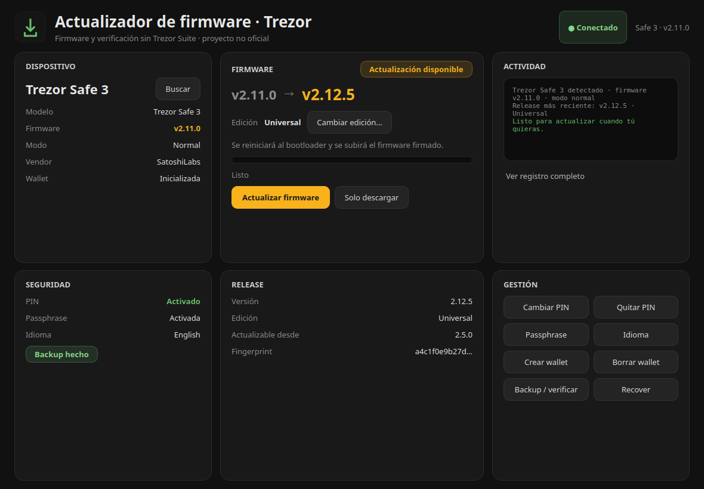
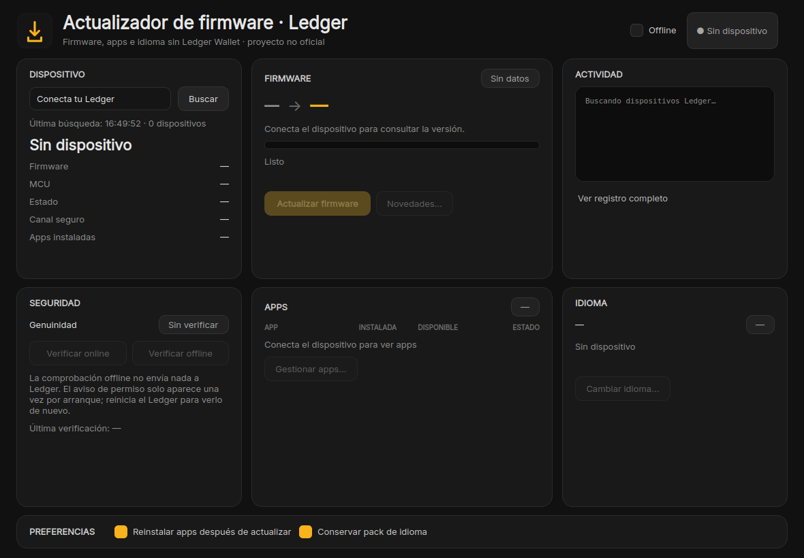
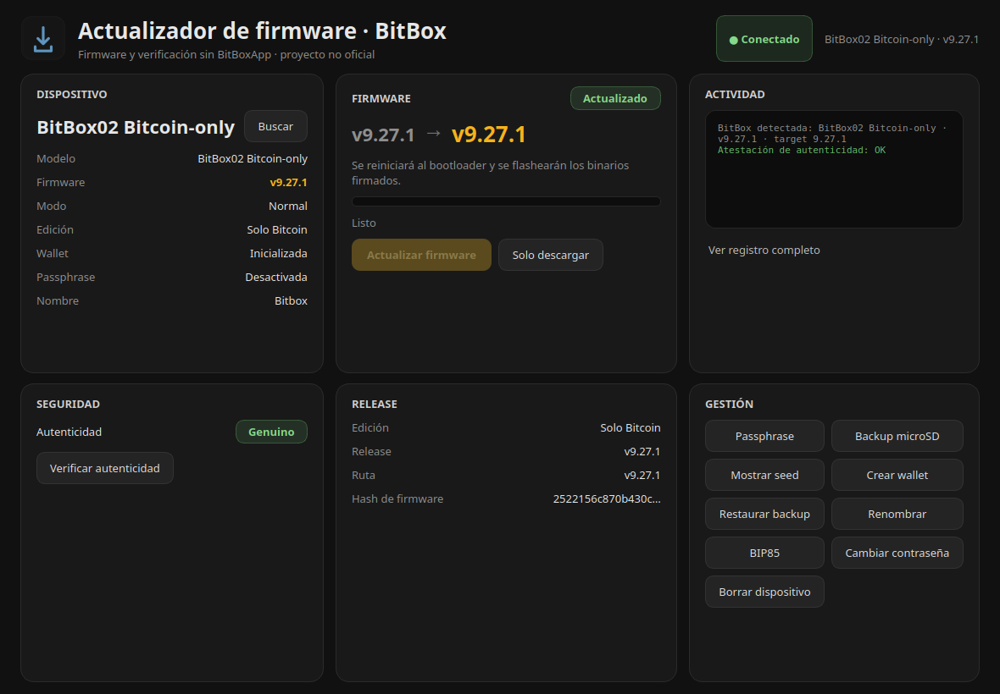

# Firmware updater for Trezor, Ledger and BitBox

> Independent, **unofficial** project. Not affiliated with, sponsored or
> endorsed by SatoshiLabs/Trezor, Ledger SAS or Shift Crypto AG. Names are used
> only to describe compatibility; they are trademarks of their owners.

Three native desktop apps that do one job: update a hardware wallet's firmware
over USB without installing the vendor's full suite.

| Trezor | Ledger | BitBox |
|---|---|---|
|  |  |  |

*Screenshots with a device connected; Trezor and Ledger use sample data to show
the full interface.*

## Why this exists

Hardware wallet firmware is a signed binary of a few megabytes. Installing it
officially means going through the vendor's desktop app, which does much more
than that:

- **Trezor Suite** is an Electron wallet with accounts, portfolio and usage
  analytics (opt-out available, but on by default). Firmware updates live
  inside that app, not as a standalone tool.
- **Ledger Live** is closed-source and the only official path for firmware,
  apps and language packs. It adds an account layer, usage analytics and a
  packaging story that does not always fit Linux (AppImage, udev rules, its own
  updater).
- **BitBoxApp** is open source, but still a complete wallet app you install and
  keep updated just to flash a device.

Updating firmware does not require a wallet, an account, a portfolio or usage
metrics. It requires talking to the device, downloading the official binary and
checking that it is what it claims to be.

So: one small window per vendor, no account, no wallet, no telemetry, showing
what it verifies while it does it.

## Privacy: what you gain

The official suites are wallets. To render balances and history they need your
account descriptors (xpubs/addresses) and query blockchain backends with them;
depending on settings they also collect usage analytics. If you only open them
to update firmware, you are exposing a wallet surface you do not need for that
task.

These apps never handle wallet data:

- **No accounts, no portfolio, no telemetry.** Nothing is sent anywhere except
  the requests needed to fetch and verify firmware.
- **No xpub, addresses, balances or history are ever read** from the device or
  requested from a network service. The device calls are system/firmware info,
  settings, and — only when you explicitly ask — seed display or backup.
- **Local logs only**, written to `~/.cache/<app>.log`; they are never uploaded.
  The BitBox pairing keys stay in the same local cache.
- **Ledger offline mode** avoids the vendor's genuine-check service entirely;
  the online check is optional and clearly labelled.

What still leaks, honestly: the firmware hosts see your IP and which
model/version you request (`data.trezor.io`, GitHub for BitBox, Ledger's manager
API). That is metadata, not wallet data, and it can be reduced with a VPN or
proxy. There is no analytics endpoint, no account ID and no wallet fingerprint
in any request this code makes.

## What it does

**Trezor**
- Detects model, firmware, edition (Universal / Bitcoin-only), PIN, passphrase,
  language and backup state.
- Downloads official firmware, verifies model and fingerprint, and shows the
  upgrade path including the minimum jump the device supports.
- Switches edition both ways, warning that it wipes the wallet.
- Management: PIN, passphrase, create/wipe wallet, backup/verify, recover and
  language.

**Ledger**
- Detects model, firmware, MCU, PIN state and whether the manager is allowed.
- Queries the published firmware for the device target, downloads it, shows the
  changelog and updates, optionally reinstalling apps.
- Lists installed and updatable apps, exports them to JSON.
- Installs language packs.
- Genuine check: online (vendor HSM) and offline.

**BitBox**
- Detects **BitBox02 and BitBox02 Nova**, in normal or bootloader mode, edition
  (Multi / Bitcoin-only) and version.
- Verifies asset SHA-256, edition magic and signature; follows intermediate
  firmware versions when required.
- Device attestation on connect.
- Pairing code shown in a dialog, not buried in the log.
- Management: passphrase, microSD backup, show seed, create/restore wallet,
  rename, BIP85, change password and factory reset.

All three keep a local log of what happened and never phone home.

## How it works

The structure is deliberately simple:

- **One app per vendor**, each with its own backend. There is no shared
  flashing layer: every device has different commands, checks and states.
  Merging them would have been more fragile, not cleaner.
- **PySide6/Qt** for the UI. Theme, dialogs and components (cards, chips, log)
  are shared between Trezor and BitBox; Ledger uses the same palette and visual
  language. A legacy Tkinter mode is kept behind `--tk` for comparison and
  debugging.
- **Worker threads**: the window never blocks while downloading or writing
  firmware. Every operation has a timeout and leaves the UI in a consistent
  state on failure.
- **Direct USB HID transport**, no Bridge and no daemon.
- **Download and verify on the client**: SHA-256, signature/magic, model and
  edition. If anything does not match, it aborts before touching the device.
- **Logs in `~/.cache/<app>.log`**, local only.

## Where everything comes from

- The code in this repository was written for this project. No UI, icons or
  assets were copied from the official suites.
- Trezor communication uses `trezorlib` (LGPL-3.0) and its official messages;
  BitBox uses the `bitbox02` library (Apache-2.0).
- Ledger has no equivalent update library: the backend speaks HID directly and
  queries the vendor's manager API and HSM, with `cryptography` for the checks.
- Firmware, translations and catalogs are **not redistributed here**: they are
  downloaded at runtime from official sources (BitBox's GitHub, Trezor's data
  hosts, Ledger's manager API) and verified before installation.
- Icons are original (an update arrow over a device). The typeface is Inter,
  under SIL OFL 1.1 (`common/fonts/OFL.txt`).
- Dependencies and their licenses are listed in `THIRD_PARTY.md`.

## Verification and security

Each app checks what it can before writing:

- **Trezor**: firmware is parsed with `trezorlib`, and the model and published
  fingerprint for that edition are checked.
- **BitBox**: asset SHA-256 against the published value, edition magic and
  signature; plus device attestation on connect.
- **Ledger**: firmware checks and the HSM response for genuineness; details in
  `docs/AUDIT-ledger.md` (Spanish).

What it **cannot** do: verify firmware on its own if the vendor publishes no
hash or verifiable signature, or replace an audit of the device code. And like
any flashing tool, an interruption can brick the device. Provided without
warranty; read `SECURITY.md` before using it with real funds.

## Status and limitations

- Developed and tested on **Linux** only. Windows and macOS are not tested.
- The BitBox flow was validated with a real BitBox02 Bitcoin-only (detection,
  pairing, attestation, backup, rename, BIP85, wipe). BitBox02 Nova uses the
  same flow with its own signed assets, selected automatically by model and
  edition; it has not been hardware-tested here yet.
- Trezor and Ledger are implemented against their official libraries and APIs.
  Not every model has been tested; when something fails, the log shows the
  step.
- This is not a wallet manager: it does not store seeds, sign transactions or
  know your xpubs.

## Verifying a release

Each release publishes a single `SHA256SUMS` file covering every AppImage and
`.deb`, signed with GPG. The primary key stays offline and the signing subkey
lives on a hardware token:

```
Primary fingerprint: B6DD B2AF 5466 FCBC 26C9  A48E 08D4 B2CC 5280 22BB
Signing subkey:      AAF4 C3A9 E887 D99F D3D3  4D3A A190 5437 5E2C 3191
```

```bash
gpg --import docs/KEY.asc          # or fetch the key from a keyserver
gpg --verify SHA256SUMS.asc SHA256SUMS
sha256sum -c SHA256SUMS
```

A good signature proves the checksums were signed by that key; the checksums in
turn prove the files were not modified. Signing does not prove how a binary was
built, only who signed the result.

## Usage

### Prebuilt Linux binaries

The [releases page](../../releases) ships, for each app:

- **AppImage** (x86_64): portable, no installation. Make it executable and run
  it. It needs udev rules for the vendor's USB IDs; the `.deb` installs them,
  or use the ones your distro already provides for the vendor's suite.
- **`.deb`** (amd64): installs to `/opt/hwfw`, adds the menu entry and the udev
  rules for that vendor.

Verify the SHA-256 checksums published with each release before running
anything.

### From source

Requirements: Linux, Python 3.11+ and `venv`.

```bash
cd trezor && ./run.sh      # creates the venv on first run
cd ledger && ./run.sh
cd bitbox && ./run.sh
```

Install the application-menu entries:

```bash
./packaging/install.sh
./packaging/install.sh --uninstall
```

### Build AppImage and .deb

```bash
VERSION=0.1.0 ./packaging/build_linux.sh
```

The script runs PyInstaller for each app and produces `build/appimage/` and
`build/deb/`, with SHA-256 files. Python interpreters can be overridden with
`PY_TREZOR`, `PY_LEDGER` and `PY_BITBOX`. It is intentionally unsigned: sign
the artifacts yourself if you redistribute them.

Regenerate the README screenshots without hardware, using sample data:

```bash
python docs/make_screenshots.py bitbox   # or trezor / ledger
```

## Layout

```
common/        shared UI (theme, dialogs, jobs) and Inter font
trezor/        Qt app, backend and Tkinter mode
ledger/        Qt app, backend, tests and audit
bitbox/        Qt app and backend
icons/         original icons
packaging/     desktop launcher installer
docs/          screenshots and audit
```

## License and trademarks

Code under MIT (`LICENSE`). Dependencies and font in `THIRD_PARTY.md`.

Trezor® is a trademark of SatoshiLabs s.r.o. Ledger® is a trademark of Ledger
SAS. BitBox® is a trademark of Shift Crypto AG. This project does not use their
logos and implies no affiliation or endorsement.
